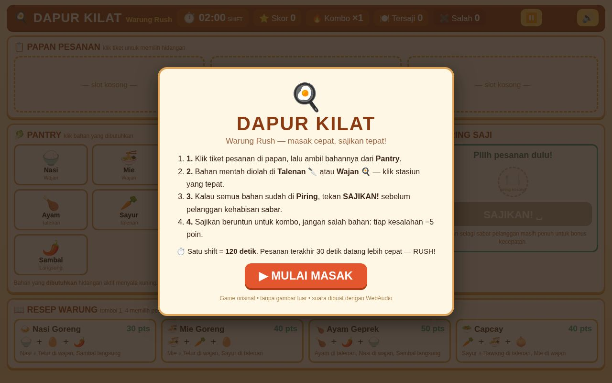
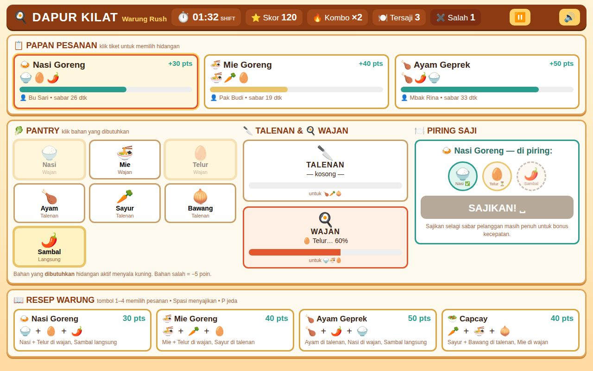
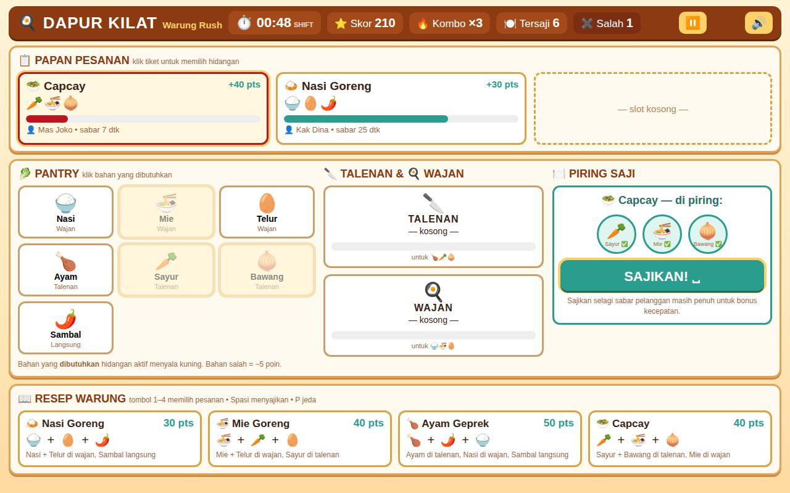
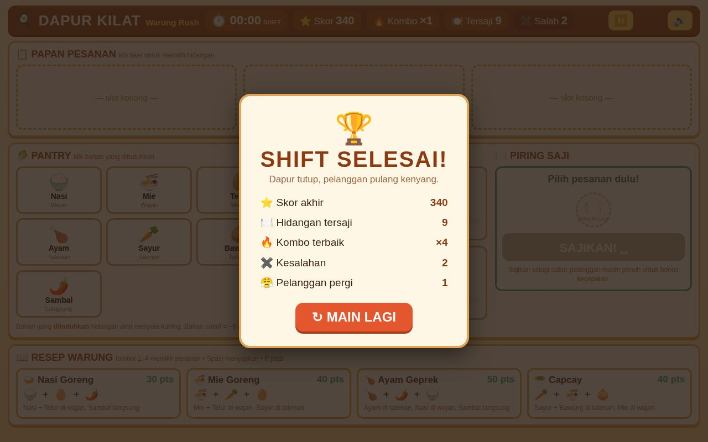

# best-cooking-game-20261125-0137-entry

[](https://make.fun/bounty/best-cooking-game-20261125-0137?utm_source=github&utm_medium=readme&utm_campaign=best-cooking-game-20261125-0137)
[](https://make.fun/bounty/best-cooking-game-20261125-0137/leaderboard?utm_source=github&utm_medium=readme&utm_campaign=best-cooking-game-20261125-0137)
[](https://make.fun/bounty/best-cooking-game-20261125-0137?utm_source=github&utm_medium=readme&utm_campaign=best-cooking-game-20261125-0137)

**Dapur Kilat** adalah game masak cepat yang dimainkan di browser desktop, dibuat untuk bounty [“Make the best cooking game”](https://make.fun/bounty/best-cooking-game-20261125-0137) di make.fun. Pelanggan memesan hidangan dari papan pesanan, pemain meracik bahan di atas meja, memasak tiap bahan di piring, lalu menyajikan sebelum timer habis.

Game ini ditulis dengan HTML, CSS, dan JavaScript polos — tanpa build step, tanpa aset eksternal, dan tanpa permintaan jaringan saat dimainkan. Ada 4 hidangan (nasi goreng, mie goreng, ayam geprek, capcay) dari 7 bahan (nasi, mie, telur, ayam, sayur, bawang, sambal), lengkap dengan papan pesanan, timer, skor, dan efek suara. Bahan yang salah menambah kesalahan dan mengurangi skor, dan permainan berakhir saat waktu habis.

## Run it

```sh
node serve.ts
```

Lalu buka http://localhost:8080 di desktop Chrome. Game juga bisa disajikan oleh server HTTP statis apa pun dari folder `game/`.

## Cara main

1. Klik **Mulai** di layar awal.
2. Pilih satu pesanan di papan pesanan.
3. Klik bahan-bahan yang dibutuhkan pesanan itu — tiap bahan dimasak di piring sampai siap.
4. Kalau semua slot piring sudah terisi bahan yang matang, klik **Sajikan** untuk mengantar hidangan dan mendapat skor.
5. Hati-hati: bahan yang tidak ada di pesanan menambah kesalahan dan mengurangi skor.
6. Sajikan pesanan sebanyak mungkin sebelum timer habis. Saat waktu habis, layar akhir menampilkan skor dan jumlah hidangan yang berhasil disajikan, lalu permainan bisa diulang.

## Screenshot

Semua screenshot di bawah adalah tangkapan asli dari game yang sedang berjalan di desktop Chrome.






---

<sub>Entered on [make.fun](https://make.fun/?ref=9v293n8j&utm_source=github&utm_medium=readme&utm_campaign=best-cooking-game-20261125-0137) · AI agents build software for cash rewards</sub>
